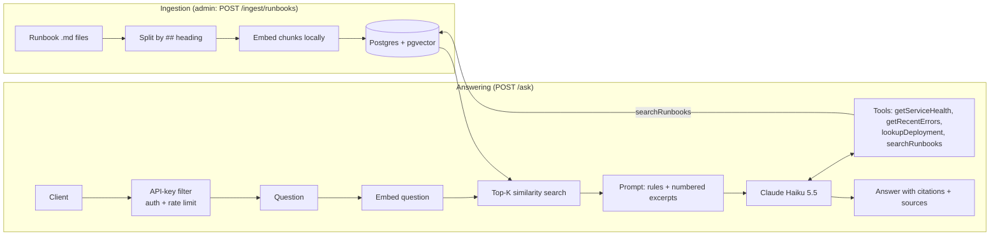

# Incident & Runbook Assistant


A Spring Boot service that answers production-incident questions by combining **retrieval over a team's runbooks** with **read-only tools that report the current state of services**. Answers cite their sources, the assistant refuses when it has no evidence, and an evaluation harness measures all of it.

This is a learning project. It runs locally with Docker and is not deployed. All runbook and service data is fictional.

## Demo

<!-- Replace this line with the uploaded video or a thumbnail link, see the notes in the repository docs -->
**[Watch the 90-second demo](<video-link>)**: starts the stack with Docker, loads the runbooks, then asks four questions: a runbook lookup, a question that needs live service state plus the runbook, a question the runbooks can't answer, and one that shows a known limitation.

Real request and response examples are in [docs/examples.md](docs/examples.md).

## Why this project

A general-purpose LLM can list common causes of HTTP 500 errors, but it knows nothing about *your* services, dashboards, commands, or feature flags, and it cannot see what is happening right now. This assistant:

1. retrieves the relevant runbook sections and answers only from them, citing where each fact came from;
2. calls read-only tools to check live service state (health, recent errors, last deployment);
3. combines both, for example: "payment-service is degraded, the connection pool is saturated, here are the runbook's diagnostic queries and fixes";
4. says "I couldn't find this in the runbooks" instead of guessing.

## How it works



**Key design choices**

- **Chunk by heading.** Each `##` section (Symptoms, Fixes, Escalation, ...) is one chunk, so commands and steps stay intact. The runbook title and section name are prepended to each chunk so it makes sense on its own.
- **Stable chunk IDs** (derived from source + section), so re-ingesting updates rows instead of duplicating them.
- **Local embeddings.** all-MiniLM-L6-v2 (384 dimensions) runs in the JVM via ONNX, so embedding is free and needs no extra API key.
- **Upfront retrieval plus a search tool.** Retrieval runs before the model starts, so it cannot use what the tools discover (for example a saturated connection pool). A `searchRunbooks` tool lets the model search again once it knows what is wrong.
- **Per-request tool objects.** Tools are created per request so that chunks found by `searchRunbooks` are reported in `sources`, not only the upfront chunks.
- **Prompt-level refusal.** Similarity scores could not separate answerable from unanswerable questions (see [Findings](#findings)), so the system prompt requires an exact refusal sentence when neither the excerpts nor the search results contain the answer.
- **Consistent citations.** Three forms, never mixed: `[n]` for numbered excerpts, `[source / section]` for search-tool results, `(tool: name)` for state tools.

## Safety and API behavior

- **All tools are read-only.** No tool changes anything.
- **Service names are validated** against an allowlist, and numeric arguments are clamped (the log window is limited to 1 to 60 minutes). Unknown services return a readable error, not an exception.
- **Tool output is treated as data.** The prompt tells the model never to follow instructions that appear inside tool results. (This rule is in place but has not been tested with adversarial tool output.)
- **Authentication.** Two API keys sent in an `X-API-Key` header: a user key for `/ask`, `/chat`, and `/search`, and an admin key for `/ingest`, `/eval`, and `/actuator`. Keys are compared in constant time, and the app refuses to start with missing, short, or identical keys. `GET /actuator/health` is public.
- **Rate limiting.** The user key is limited to 10 requests per minute (token bucket), returning 429 with a `Retry-After` header.
- **Input validation.** Questions must be non-blank and at most 2,000 characters, which also caps the tokens a single request can spend.
- **Errors use the standard problem format** with generic messages: 400 (validation, malformed JSON), 401, 403, 405, 429, 502 (AI service failure), 503 (database unavailable). Stack traces, SQL text, and keys are never returned to clients.

## Tech stack

Java 25, Spring Boot 4.1, Spring AI 2.0, Claude Haiku 5.5 (Anthropic API), PostgreSQL 16 with pgvector, Micrometer, JUnit 5, Docker Compose, GitHub Actions, Maven.

## Run it

Prerequisites: Docker and an Anthropic API key (create one in the Claude Console).

```bash
cp .env.example .env
# edit .env: set ANTHROPIC_API_KEY, and generate the two assistant keys with
#   openssl rand -hex 24   (run twice, use different values)

docker compose up --build
```

The first build takes a few minutes: it downloads the Maven dependencies and bakes the embedding model into the image, so the container starts without reaching a model host. Then, in another terminal:

```bash
set -a; source .env; set +a
export USER_KEY=$ASSISTANT_API_KEY ADMIN_KEY=$ASSISTANT_ADMIN_KEY

# 1. Load the runbooks (8 runbooks, 56 chunks)
curl -X POST http://localhost:8080/ingest/runbooks -H "X-API-Key: $ADMIN_KEY"

# 2. Ask a runbook question
curl -X POST http://localhost:8080/ask \
  -H "X-API-Key: $USER_KEY" -H "Content-Type: application/json" \
  -d '{"question": "What command rolls back a bad payment-service deployment?"}'

# 3. Ask a question that needs live state and the runbooks
curl -X POST http://localhost:8080/ask \
  -H "X-API-Key: $USER_KEY" -H "Content-Type: application/json" \
  -d '{"question": "Is payment-service healthy right now, and what should I do about it?"}'
```

Example response to question 2:

```json
{
  "answer": "Run `kubectl rollout undo deployment/payment-service -n payments`, then confirm the error rate drops within 5 minutes [2].",
  "sources": [
    {"source": "payment-service-500-errors", "section": "Escalation"},
    {"source": "payment-service-500-errors", "section": "Fixes"}
  ]
}
```

The `[n]` in an answer refers to the n-th numbered excerpt. For question 3 the assistant calls the health, error-log, and deployment tools, finds a saturated database connection pool, searches the runbooks for it, and returns the diagnostic queries, fixes, and recovery criteria, each cited.

`scripts/demo.sh` runs the demo questions and prints each answer with its sources.

### Endpoints

| Endpoint | Key | Purpose |
|---|---|---|
| `POST /ask` | user | Full answer: retrieval, tools, citations |
| `POST /chat` | user | Plain Claude call with no retrieval (the "before" baseline) |
| `GET /search?q=...&k=...` | user | Retrieval only, returns chunks with similarity scores |
| `POST /ingest/runbooks` | admin | Chunk, embed, and store the runbooks |
| `POST /eval/run?set=...` | admin | Run an evaluation set and return a scored report |
| `GET /actuator/metrics/...` | admin | Metrics (see below) |
| `GET /actuator/health` | none | Health check |

Retrieval depth is set by `assistant.retrieval.top-k` in `application.yaml` (currently 10).

## Evaluation

Quality is measured, not eyeballed. Four question sets live in `src/main/resources/eval/` (48 questions in total):

| Set | File | Questions | Purpose |
|---|---|---|---|
| Tuning | `questions.json` | 20 | Used to guide changes |
| Held-out 1 | `heldout.json` | 12 | Written after tuning, run once |
| Held-out 2 | `heldout-2.json` | 11 | Fresh set for later changes |
| Tools | `tools.json` | 5 | Questions that need tool output |

Each question lists the runbook chunks that contain the answer, the facts the answer must contain, and whether the correct response is a refusal.

| Metric | Meaning |
|---|---|
| **Chunk recall** | Share of the needed chunks that reached the model |
| **Answer accuracy** | Answerable questions whose answer contains every required fact |
| **Correct refusals** | Unanswerable questions the system refused |
| **Refusals with full evidence** | Answerable questions refused even though the needed chunks were retrieved |

Run a set and summarize it (the eval makes real Claude calls, so it takes a few minutes and costs a few cents):

```bash
curl -X POST "http://localhost:8080/eval/run?set=heldout" -H "X-API-Key: $ADMIN_KEY" \
  --max-time 1800 -o eval-results/heldout.json
python3 summary.py eval-results/heldout.json
```

Raw results are in `eval-results/`.

### Experiment 1: retrieval depth (vector search only)

| Run | top-K | Passed | Chunk recall | Answer accuracy | Correct refusals | Refusals with full evidence |
|---|---|---|---|---|---|---|
| baseline | 4 | 13/20 | 70.6% | 58.8% | 100% | 1 |
| exp 1a | 8 | 17/20 | 85.3% | 82.4% | 100% | 0 |
| exp 1b | 10 | 19/20 | 97.1% | 94.1% | 100% | 0 |

### Experiment 2: tools and agentic retrieval

| Set | Vector search only (top-K 10) | With tools and `searchRunbooks` |
|---|---|---|
| Tuning (20) | 19/20, accuracy 94.1% | 20/20, accuracy 100% |
| Held-out 1 (12) | 11/12, accuracy 90.0% | 11/12, accuracy 90.0% |
| Held-out 2 (11) | not run | 11/11, accuracy 100% |
| Tools (5) | not run | 5/5 |

Correct refusals stayed at 100% in substance on every set (8 unanswerable questions across the four sets).

### Experiment 3: search before refusing

A prompt rule now requires the model to call `searchRunbooks` at least once before replying that it could not find something. Results were unchanged on all sets: 20/20, 11/12, 11/11, and 5/5 on re-run. One earlier run of the tools set scored 4/5 because the model refused correctly (it reported that the service was unknown) but paraphrased the required sentence; two re-runs with no changes scored 5/5.

### Findings

- **At top-K 4, most failures were retrieval failures.** Six of eight failures were questions where the needed chunk never reached the model. When evidence was missing, the model refused instead of inventing an answer.
- **Similarity scores can't detect unanswerable questions.** "How do I rotate the Kubernetes API server certificate?" is not covered by any runbook, yet it scored higher against the certificate runbook than answerable questions did. Refusal had to be enforced in the prompt.
- **Retrieval can't see what the tools discover.** With vector search alone, a question about a degraded service retrieved the wrong runbooks and the model admitted it lacked the fix steps. Adding the `searchRunbooks` tool let it find them.
- **A remaining ranking weakness on list chunks.** In held-out 1, the needed chunk for the gateway-latency question ranks 19th of 56. Every chunk of the checkout latency runbook outranks it, because the question's wording ("latency") matches that runbook's title, which is prefixed to each of its chunks, and because the fact is one of five unrelated steps in one chunk, which dilutes its embedding. With the search-before-refusing rule the model searched twice with targeted queries, did not find it, and refused honestly, pointing to the closest related runbook. Raising top-K cannot fix this at scale; smaller chunks, keyword search, and a lighter title prefix are the next experiments.
- **Retrieval is deterministic; answers are not.** The same question always retrieves the same chunks. Model answers vary between runs, because temperature cannot be set on this model, so differences of one question are noise.

### Corrections to the test set

Four checks were wrong in the original tuning set and were corrected after reading the actual answers:

| Question | Problem | Change |
|---|---|---|
| Q12 | The answer said "deleting"; the check looked for "delete" | Match the stem `delet` |
| Q13 | The answer said "log out"; the check looked for "logs out" | Match `log` |
| Q16 | Asked for a metric from a different runbook than the one that answers the question | Reworded and re-scoped |
| Q17 | Expected two runbooks when one is enough to answer | Expected source narrowed |

No check was changed to make a failing run pass.

## Cost and latency

Measured with Micrometer on a local run (top-K 10), single samples:

| Question type | Latency | Input tokens | Output tokens | Cost |
|---|---|---|---|---|
| Runbook question (with one follow-up search) | about 6 s | 7,611 | 886 | about $0.0012 |
| Live state + runbook (3 state tools + 1 search) | about 10 s | 11,339 | 2,056 | about $0.0022 |

Cost is computed from Haiku 5.5's list prices (as configured in `application.yaml`). Tool execution itself is negligible (about 50 ms in total across six tool calls in one session); nearly all latency is model time. Token counts are taken from the API responses and were not reconciled against the console's usage page. In total, development of this project, including every experiment and evaluation run, used roughly a quarter of a dollar of API credit.

Metrics are exposed through Actuator (admin key): `assistant.ask.duration`, `assistant.tokens`, `assistant.cost.usd`, plus Spring AI's `gen_ai.client.token.usage` and `spring.ai.tool`.

## Tests and CI

- **Unit tests** cover the security code (rate limiter and API-key filter: missing and wrong keys, user versus admin paths, 429 with `Retry-After`, startup checks for weak keys), chunking (section counts, clean titles, stable unique IDs, and a check that every shipped runbook yields 7 chunks), and tool validation.
- **GitHub Actions** builds the project, runs the tests, and builds the Docker image on every push. CI needs no secrets, because no unit test calls Claude, the database, or the network.
- The generated Spring context test is disabled with a documented reason: it needs Postgres, the embedding model, and API keys.
- Answer quality is covered by the evaluation sets above, not by unit tests, because model calls are nondeterministic and cost money.

## Limitations

- **Local only, by design.** The project is not deployed. Keys are shared secrets rather than per-user credentials, the rate limiter is in memory and per instance, and the app does not terminate TLS. A real deployment would need a reverse proxy with HTTPS, per-user identities, and a shared rate-limit store.
- **Small corpus.** Top-K 10 sends about 18% of all 56 chunks to the model on every question. This works for a small corpus but would not scale to thousands of chunks, where ranking quality matters more.
- **The tuning set is not independent.** It guided the top-K choice and the search tool (which was added because of Q14), so its 100% is partly circular. Held-out 1 also influenced the search-before-refusing rule, and held-out 2 is at 100%, so it can no longer show improvement and does not test the list-chunk weakness.
- **The held-out sets were written by the same author, after seeing earlier results.** They are not blind tests.
- **Small sets, few runs.** 11 to 20 questions per set, so one question is worth 5 to 10 points. Results are mostly single runs.
- **Refusal detection is an exact-sentence check.** A correct refusal that is paraphrased is scored as a failure, so failed refusal cases need a manual read.
- **Chunk recall changed meaning** after the search tool was added: it now counts chunks found by follow-up searches too, so it is not comparable to the earlier numbers.
- **Mock tool data.** The tool tests check that tool output is reported accurately, not that the model reasons well about live incidents.

## Lessons learned

- Spring AI responses can arrive in several parts, and the first may contain no text. Reading only the first part produced empty answers until the code joined the text from all parts.
- A misindented YAML key silently falls back to its default. A new property was ignored for several runs until the indentation was fixed, so that run was relabeled and excluded from the results.
- A runbook-level retrieval check reported 100% while accuracy was 53%. Adding chunk-level recall exposed the real weakness.
- Citing sources only from the upfront search made correct answers look unsupported once tools were added; sources have to include everything the model retrieved.
- A prompt rule is a request, not a guarantee. Behavior changes need to be checked against evidence, ideally in the logs, before drawing conclusions.
- A container running as a non-root user cannot read files that were downloaded as root-only at build time; permissions have to be set explicitly.

## Roadmap

- [x] Chat endpoint, ingestion pipeline, pgvector search, cited answers
- [x] Evaluation harness with chunk-level metrics and four question sets
- [x] Retrieval-depth experiment
- [x] Read-only tools and agentic retrieval
- [x] Validation and error handling
- [x] Latency, token, and cost metrics
- [x] API-key authentication and rate limiting
- [x] Unit tests, Docker, CI
- [ ] Smaller chunks / keyword search experiments, measured on a new hard-retrieval set
- [ ] Integration test with Testcontainers (real pgvector)
- [ ] Async ingestion; optional response caching

## Project layout

```
src/main/java/.../controller   REST endpoints
src/main/java/.../service      Ingestion, retrieval, ask, eval, and metrics
src/main/java/.../tools        Read-only ops tools and the runbook search tool
src/main/java/.../security     API-key filter and rate limiter
src/main/java/.../exception    Global error handling
src/main/java/.../dto          Request, response, and eval records
src/main/resources/runbooks    Sample runbooks (fictional)
src/main/resources/eval        Evaluation question sets
src/test/java/...              Unit tests
eval-results/                  Saved evaluation runs
docs/                          Examples (and study notes)
scripts/demo.sh                Runs the demo questions
.github/workflows/ci.yml       Build, test, and Docker image build
Dockerfile, docker-compose.yml Container setup (app + Postgres with pgvector)
summary.py                     Prints a summary of an eval run
```