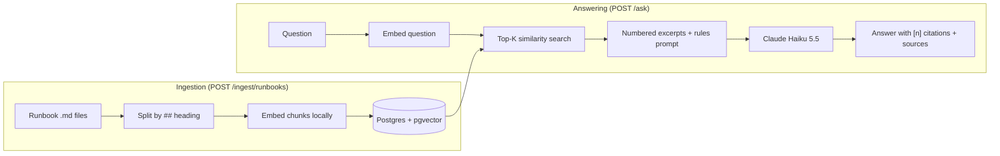

# Incident & Runbook Assistant

A Spring Boot service that answers production-incident questions **from a team's own runbooks** using retrieval-augmented generation (RAG), with source citations and an evaluation harness that measures answer quality.

> **Status: work in progress.** Retrieval, grounded answers, and evaluation are working. Tool calling, authentication, caching, metrics, and deployment are planned (see [Roadmap](#roadmap)).

## Why this project

A general-purpose LLM can list common causes of HTTP 500 errors, but it knows nothing about *your* services, dashboards, commands, or feature flags. This assistant retrieves the relevant runbook sections and makes the model answer only from them, citing where each fact came from. If the runbooks don't contain the answer, it says so instead of guessing.

## How it works



**Key design choices**

- **Chunk by heading.** Each `##` section (Symptoms, Fixes, Escalation, ...) is one chunk, so commands and steps stay intact. The runbook title and section name are prepended to each chunk so it makes sense on its own.
- **Stable chunk IDs** (derived from source + section), so re-ingesting updates rows instead of duplicating them.
- **Local embeddings.** all-MiniLM-L6-v2 (384 dimensions) runs on the machine via ONNX, so embedding is free and needs no extra API key.
- **Prompt-level refusal.** Similarity scores could not separate answerable from unanswerable questions (see [Findings](#findings)), so the system prompt requires an exact refusal sentence when the excerpts lack the answer. A fixed sentence also makes refusals easy to detect in the eval.

## Tech stack

Java 25+, Spring Boot 4.1, Spring AI 2.x, Claude Haiku 5.5 (Anthropic API), PostgreSQL 16 with pgvector, Docker Compose, Maven.

## Run it locally

Prerequisites: Java 25+, Docker, an Anthropic API key.

```bash
docker compose up -d                      # Postgres + pgvector
export ANTHROPIC_API_KEY=your-key         # never commit this
./mvnw spring-boot:run
```

The first start downloads the embedding model files (cached afterwards). Then:

```bash
# 1. Load the runbooks (56 chunks from 8 runbooks)
curl -X POST http://localhost:8080/ingest/runbooks

# 2. Ask a question
curl -X POST http://localhost:8080/ask \
  -H "Content-Type: application/json" \
  -d '{"question": "What command rolls back a bad payment-service deployment?"}'
```

Example response:

```json
{
  "answer": "Run `kubectl rollout undo deployment/payment-service -n payments`, then confirm the error rate drops within 5 minutes [2].",
  "sources": [
    {"source": "payment-service-500-errors", "section": "Escalation"},
    {"source": "payment-service-500-errors", "section": "Fixes"}
  ]
}
```

The `[n]` in the answer refers to the n-th entry of `sources`.

### Endpoints

| Endpoint | Purpose |
|---|---|
| `POST /chat` | Plain Claude call with no retrieval (the "before" baseline) |
| `POST /ingest/runbooks` | Chunk, embed, and store the runbooks |
| `GET /search?q=...&k=...` | Retrieval only, returns chunks with similarity scores |
| `POST /ask` | Full RAG answer with citations |
| `POST /eval/run` | Run the evaluation set and return a scored report |

Retrieval depth is set by `assistant.retrieval.top-k` in `application.yml` (currently 10).

## Evaluation

Quality is measured, not eyeballed. `src/main/resources/eval/questions.json` holds 20 questions (7 lookups, 6 procedural, 4 cross-runbook, 3 unanswerable), each with the runbook chunks that contain the answer, the facts the answer must contain, and whether the correct response is a refusal.

| Metric | Meaning |
|---|---|
| **Chunk recall** | Share of the needed chunks that reached the model |
| **Answer accuracy** | Answerable questions whose answer contains every required fact |
| **Correct refusals** | Unanswerable questions the system refused |
| **Refusals with full evidence** | Answerable questions refused even though the needed chunks were retrieved |

### Experiment: retrieval depth (top-K)

| Run | top-K | Passed | Chunk recall | Answer accuracy | Correct refusals | Refusals with full evidence |
|---|---|---|---|---|---|---|
| baseline | 4 | 13/20 | 70.6% | 58.8% | 100% | 1 |
| exp 1a | 8 | 17/20 | 85.3% | 82.4% | 100% | 0 |
| exp 1b | 10 | 19/20 | 97.1% | 94.1% | 100% | 0 |

Raw results are in `eval-results/`. Summarize any run with `python3 summary.py eval-results/<file>.json`.

### Findings

- **Failures were retrieval failures.** At top-K 4, six of the eight failures were questions where the needed chunk never reached the model. When the evidence was missing, the model refused rather than inventing an answer.
- **Similarity scores can't detect unanswerable questions.** "How do I rotate the Kubernetes API server certificate?" is not covered by any runbook, yet it scored higher against the certificate runbook than answerable questions did. Refusal had to be enforced in the prompt, and it held at 100% in every run.
- **The remaining failure (Q14)** needs a `Fixes` chunk that ranks 12th for a mixed "what should I check and how do I fix it" question. The question names the service and metric, so the runbook's `Overview`, `Verification`, and `Escalation` chunks outrank the section that holds the fix. Likely remedies: one chunk per fix bullet, keyword search alongside vector search, or query rewriting.

### Corrections to the test set

Four checks were wrong in the original set and were corrected after reading the actual answers:

| Question | Problem | Change |
|---|---|---|
| Q12 | The answer said "deleting"; the check looked for "delete" | Match the stem `delet` |
| Q13 | The answer said "log out"; the check looked for "logs out" | Match `log` |
| Q16 | Asked for a metric from a different runbook than the one that answers the question | Reworded and re-scoped |
| Q17 | Expected two runbooks when one is enough to answer | Expected source narrowed |

No check was changed to make a failing run pass.

### Limitations

- **Small corpus.** Top-K 10 sends about 18% of all 56 chunks to the model on every question. This is a cheap fix that would not scale to thousands of chunks, where ranking quality matters more.
- **Tuned on the measured questions.** The 20 questions guided the tuning, so results may overstate real-world performance. A held-out set is planned.
- **One run per setting.** The model's temperature can't be set, so answers vary slightly between runs. A one- or two-question difference is within noise; the 13 to 19 jump is not.
- **Cost.** Top-K 10 uses roughly 2.5x the input tokens of top-K 4 (still a fraction of a cent per question).

## Lessons learned

- Spring AI responses can arrive in several parts, and the first may contain no text. Reading only the first part produced empty answers until the code joined the text from all parts.
- A misindented YAML key silently falls back to its default. A new property was ignored for several runs until the indentation was fixed, so the run was relabeled and excluded from the results.
- A runbook-level retrieval check reported 100% while accuracy was 53%. Adding chunk-level recall exposed the real weakness.

## Roadmap

- [x] Spring Boot + Claude chat endpoint
- [x] Ingestion pipeline, pgvector search, cited answers
- [x] Evaluation harness with chunk-level metrics
- [x] Retrieval-depth experiment
- [ ] Held-out evaluation questions
- [ ] Smaller chunks / keyword search experiments
- [ ] Tool calling (service health, recent errors, deployment lookup; read-only)
- [ ] Async ingestion, authentication, rate limiting, caching
- [ ] Latency, token, and cost metrics per query
- [ ] Integration tests, Docker image, CI, deployment
- [ ] Demo GIF and architecture write-up

## Project layout

```
src/main/java/.../controller   REST endpoints
src/main/java/.../service      Ingestion, retrieval, ask, and eval logic
src/main/resources/runbooks    Sample runbooks (fictional)
src/main/resources/eval        Evaluation questions
eval-results/                  Saved evaluation runs
```

All runbook content is fictional and written for this project.
